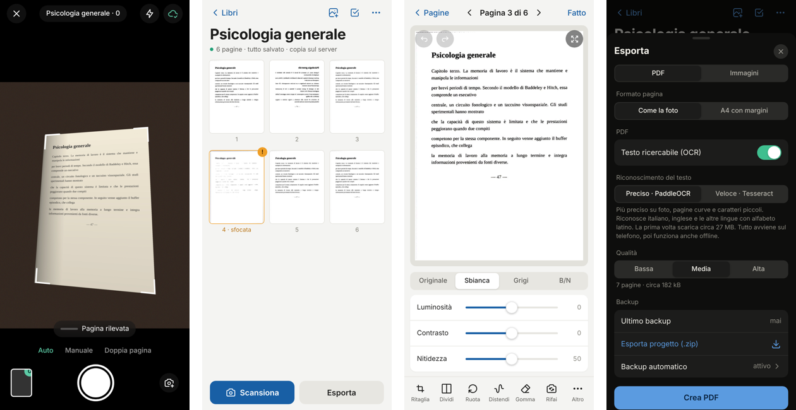

# Pageturn

*[Italiano](README.md) · [English](README.en.md) · 中文*

在手机浏览器里运行的图书扫描工具，把书页扫描成 PDF。不用应用商店，不用注册账号，也不经过第三方云服务：它是一个网页应用，可以添加到主屏幕，离线也能用，并且完全开源。

**在线试用：** https://lorenzaferazzoli.github.io/pageturn-pdfscan/



## 功能

- **自动拍摄。** 在取景框里识别书页，书页稳定、清晰时自动拍下。然后等你翻页：先看到你的手，再看到新的一页，接着再拍。也可以手动拍摄；遇到难拍的页面，还可以用 iOS 自带相机以全分辨率拍摄。
- **防抖。** 每次拍摄都会比较连续的几帧，保留最清晰的一帧，清晰度直接按页面上的文字来衡量。手动拍摄时，点按后会稍等片刻，让手机先稳住。
- **扫描不会丢。** 每张照片拍下后立即写入浏览器存储，然后才开始处理。即使应用关闭或手机没电，重新打开后一切都在。
- **自动备份到你自己的服务器**（可选）。每张照片保存后立即发送到你的服务器；网络中断时会自动重试。你也可以把项目导出为 .zip 文件，之后再导入。
- **自动拉正页面**：校正透视，四个角可以手动调整。
- **增白**：纸张变白，去掉书脊处的阴影和泛黄。逐页把墨迹调成纯黑，锐化在两个尺度上进行，强度可调。滤镜有原图、增白、灰度和黑白，每种都可以调亮度、对比度和锐度。
- **摊开的书**：能找到两页之间的折痕。单页模式下保留完整的一页，去掉对面那页露出的一条；*双页*模式下，每次拍摄沿折痕分成两页。
- **精确找角**：结合两种方法，一是最亮的纸张区域，二是书页的直线边缘（霍夫变换），边上真实边缘最多的四边形胜出。浅色、杂乱的背景上也能用，手指压住一个角也不会把它带偏。之后还会在更大的图像上沿每条边逐点重新测量，让边缘更精确；文字栏的边缘也不会被误当成书的折痕。
- **精确裁剪**：可以拖动四个角，也可以整条边拖动，并带放大镜。
- **自由查看**：全屏双指缩放、拖动，可以看全分辨率的页面或原始照片，用来检查是否拍糊了。
- **拆分**：拆分线从识别到的折痕开始，可以移动、倾斜。
- **撤销与重做**：页面上的每一步修改都可以撤销，拆分也不例外。
- **修改应用于所有页面**（*更多*菜单，可开可关）：滤镜、亮度、对比度、锐度和*展平*对整本书生效。
- **A4 PDF**：四周留 1 厘米边距；也可以让页面保持照片的尺寸。
- **橡皮擦**：擦掉污渍、铅笔痕迹和边缘的手指。笔画立刻出现在手指下，真正的效果稍后呈现，放大镜会显示正在擦除的地方。之后再打开或关闭*展平*，笔画也会留在原处。
- **模糊提醒**、旋转、拖动排序、单页重拍。
- **弯曲的页面**：*展平*工具可以把书脊附近弯曲的文字行拉直，作用于一页或所有选中的页面。UVDoc 模型估计页面的形状，应用再把它变成一个光滑的曲面（朝书脊弯曲的一张纸，没有波纹），然后沿着文字行把剩下的弯曲拉直。页面从全分辨率照片重新采样。
- **在手机上进行 OCR**，有两个引擎：*精确*（PaddleOCR PP-OCRv5，支持意大利语、英语及其他拉丁字母语言）和*快速*（Tesseract）。生成的 PDF 带有可搜索、可选中的文字层。暂不支持识别中文。
- **导出** PDF（三种质量）或 JPEG 图片，可以导出整本书，也可以只导出选中的页面（*选择* → *导出*）。通过“分享”菜单可以直接存到“文件”、iCloud 云盘、Google 云端硬盘或 Dropbox。
- **轻快。** 处理在后台进行：测试中连续处理 120 页，界面始终不卡。
- **浅色和深色主题**，可自动切换，也可手动选择。
- **意大利语、英语和中文界面。** 默认跟随手机语言，也可以在*设置 → 语言*中选择。

## 在 iPhone 上安装

1. 用 Safari、Opera、Chrome、Edge 或 Firefox 打开 https://lorenzaferazzoli.github.io/pageturn-pdfscan/ 。
2. 点按**分享**，再点按**添加到主屏幕**。
3. 从图标打开 Pageturn，并允许使用相机。

安装这一步很重要。Safari 可能会删除 7 天内没有访问过的网站数据，但添加到主屏幕的应用不受此限制。从 iOS 16.4 起，任何浏览器都可以添加。安装后，应用从自己的图标打开、独立运行，与添加它时用的浏览器无关。

注意：安装后的应用和浏览器里打开的同一个网页，**存储是分开的**。如果你已经在浏览器里扫描过，请先在浏览器里导出备份（.zip），再导入已安装的应用（*设置 → 导入备份*）。

在*设置 → 关于 → 运行环境*中，应用会显示它运行在哪里：浏览器、引擎、能否离线使用，以及 OCR 是否多线程。

在 Android 上用 Chrome 也是一样（菜单 ⋮ → *安装应用*）。

## 自行部署

自带的服务器既提供应用本身，也接收页面的自动备份，没有任何依赖。

**使用 Node 18 或更高版本**

```sh
git clone https://github.com/lorenzaferazzoli/pageturn-pdfscan.git
cd pageturn-pdfscan
PAGETURN_TOKEN=一个密码 node server/server.js
```

**使用 Docker**

```sh
docker compose up -d   # 先在 docker-compose.yml 里设置 PAGETURN_TOKEN
```

备份保存在 `./data/<书>/pages/` 中：原始 JPEG，加上每页一个 .json 文件。

在应用中打开**设置 → 自动备份到服务器**，填入地址和访问码，然后点按*测试连接*。如果直接从你的服务器打开应用，并且没有设置访问码，备份会自动开启。

**必须使用 HTTPS。** 浏览器只允许在 HTTPS（或 `localhost`）下使用相机。最简单的几种做法：

- [Tailscale](https://tailscale.com/kb/1312/serve)：`tailscale serve 8080` 会给你一个只有自己的设备能访问的 HTTPS 地址；
- 带自动证书的反向代理，例如 [Caddy](https://caddyserver.com/)：`reverse_proxy localhost:8080`；
- 使用你自己的证书：`TLS_CERT=cert.pem TLS_KEY=key.pem node server/server.js`。

也可以从 GitHub Pages 使用应用，只把服务器用来备份。服务器接受来自其他来源的请求，可以用 `CORS_ORIGIN` 加以限制。

| 变量 | 默认值 | 含义 |
|---|---|---|
| `PORT` | `8080` | 端口 |
| `DATA_DIR` | `./data` | 备份文件夹 |
| `PAGETURN_TOKEN` | 无 | 应用必须提供的访问码 |
| `TLS_CERT`, `TLS_KEY` | 无 | 直接提供 HTTPS |
| `CORS_ORIGIN` | `*` | 应用部署在别处时允许的来源 |

## 隐私

照片只保存在你的手机上，以及（如果你设置了的话）你的服务器上。OCR 在设备上完成。应用不连接任何其他服务：所有程序库都包含在仓库里。

## 已知限制

- *展平*处理的是页面周围的照片，对本来就平整的页面不做改动。折痕非常深时，页面边缘可能变形；紧挨书脊的文字可能仍然略窄。效果在预览中马上就能看到，可以关闭，也可以撤销。
- 页面放在较深的背景上时识别效果最好。在浅色背景上会依靠页面边缘的直线；但如果旁边那页和要扫描的这页一样亮，最好手动调整四个角（可以用放大镜）。
- 使用应用内相机时，分辨率就是视频流的分辨率（最高 4K，取决于手机）。字很小的页面，请用 iOS 相机以全分辨率拍摄。
- OCR 只识别拉丁字母语言，暂时不能识别中文。
- 在手机上做 OCR 每页需要几秒钟，*精确*引擎大约是*快速*的三倍时间。处理整本书时，建议让应用保持打开并接上充电器。第一次使用时需要下载模型：*精确*约 27 MB，*快速*约 10 MB，*展平*约 31 MB。

## 选哪个 OCR 引擎

在 `tests/fixtures/ocr` 的测试页面上的比较（字符错误率，越低越好；`node tests/ocr-compare.mjs`）：

| 页面 | Tesseract | PaddleOCR |
|---|---|---|
| 小说，清晰照片 | 0.0% | 0.0% |
| 带脚注的教材 | 0.7% | 0.7% |
| 低分辨率照片（700 像素） | 12.1% | 1.5% |
| 靠近书脊处弯曲的页面 | 16.1% | 0.0% |
| 教材，弯曲的页面 | 19.9% | 13.9% |

在干净的页面上两个引擎不相上下；在小尺寸照片和弯曲的页面上，PaddleOCR 的错误少得多。

## 开发

没有构建步骤：只有静态文件和 JavaScript 模块。

```sh
npm install
npm start                    # http://localhost:8080
npm test                     # 在 Chromium 中用模拟相机完整测试
node tests/stress.mjs 120    # 压力测试
node tests/stabilizer.mjs    # 防抖：每次拍摄都必须清晰
node tests/dewarp-check.mjs  # 展平：测试用弯曲页面上的文字行还剩多少弯曲
node tests/i18n.mjs          # 翻译：英文和中文界面里不能残留意大利语
node tests/detect-check.mjs  # 把页面识别结果画到 tests/out/
node tests/detect-accuracy.mjs # 页面识别：找到的角与真实角的距离
python3 tests/make-detect-set.py # 重新生成页面识别的测试照片
python3 tests/make-curved.py # 重新生成测试用的弯曲页面
npm run vendor               # 更新程序库之后运行
sh scripts/paddle-models.sh  # 重新下载 PaddleOCR 模型
```

| 文件夹 | 内容 |
|---|---|
| `js/` | 应用（`app.js`）、翻译（`i18n.js`）、存储（`db.js`）、相机、自动拍摄和防抖（`camera.js`、`detect.js`）、图像处理（`proc.js`、`render.js`，在 worker 中运行）、弯曲页面（`dewarp.js`）、队列（`queue.js`）、OCR（`ocr.js`、`paddle.js`、`paddle-worker.js`）、PDF 与备份（`export.js`）、服务器备份（`sync.js`） |
| `server/` | 无依赖的 Node 服务器 |
| `vendor/` | 随附的程序库（见 [THIRD-PARTY.md](THIRD-PARTY.md)） |
| `tests/` | 自动测试和测试图片 |

## 许可证

[GPL-3.0](LICENSE)：你可以使用、修改和再发布，但修改后的版本必须以同一许可证继续开源。
